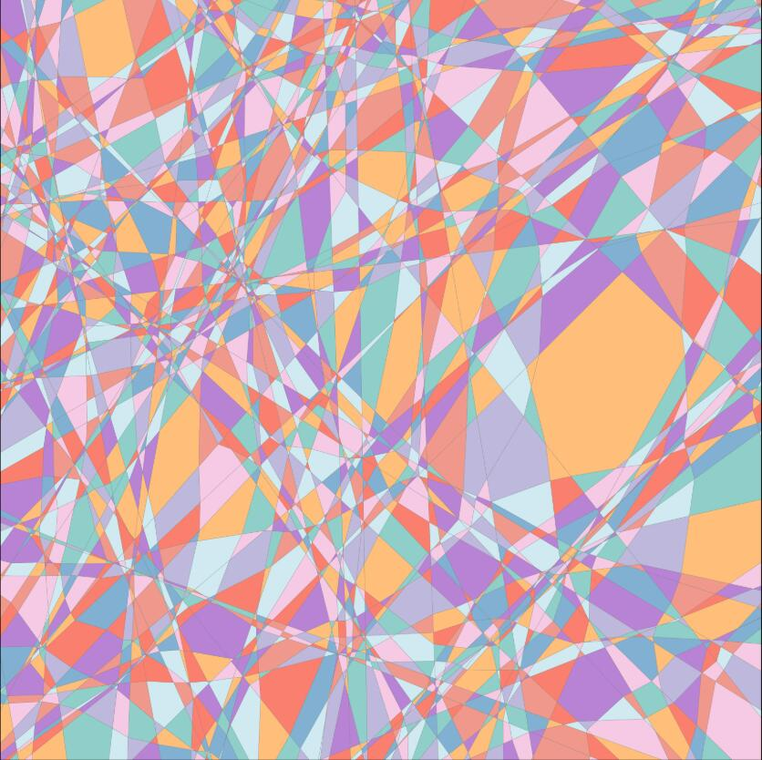

# CPAExploration: Continuous Piecewise Affine Exploration

A sample library for linear graph (weight and bias) of DNNs in [PyTorch](https://pytorch.org/). Now the library supports a few of modules. We are trying to make this library work like PyTorch.

## Features

- An thin extension of PyTorch's Module, that simplifies the creation of certain graph models.
- This library can generate the linear graph of DNNs easily by forward process.
- We will update this library to support more modules.

## Requirements

- Python        3.11 or above
- pyTorch       1.6 or above
- scipy         1.5.4 or above
- matplotlib    3.6.3
- torchversion  
- Numpy
- polytope
- scikit-learn

## Example

### Sample example

This example shows how to create a module to generate the linear graph. This example is in [graphDemo.py](examples/graphDemo.py).

```python
import numpy as np
import torch

from torchays import nn
from torchays.nn.modules import Tensor

GPU_ID = 0
device = torch.device('cuda', GPU_ID) if torch.cuda.is_available() else torch.device('cpu')
torch.manual_seed(5)
torch.cuda.manual_seed_all(5)
np.random.seed(5)


class TestNet(nn.Module):
    def __init__(self):
        super(TestNet, self).__init__()
        self.relu = nn.ReLU()
        self.conv1 = nn.Conv2d(in_channels=3, out_channels=8, kernel_size=3, stride=2, padding=1)
        self.bn1 = nn.BatchNorm2d(num_features=8)
        self.conv2 = nn.Conv2d(in_channels=8, out_channels=16, kernel_size=3, stride=2, padding=1)
        self.avg = nn.AvgPool2d(2, 1)
        self.linear = nn.Linear(16, 2)
        self.flatten = nn.Flatten(1)

    def forward(self, x):
        x = self.conv1(x)
        x = self.bn1(x)
        x = self.relu(x)

        x = self.conv2(x)
        x = self.avg(x)

        x = self.flatten(x)

        x = self.linear(x)
        return x


if __name__ == "__main__":
    net = TestNet().to(device)
    data = torch.randn(2, 3, 8, 8).to(device)

    net.graph()
    with torch.no_grad():
        output: Tensor = net(data)
        weight, bias = output.weight_graph, output.bias_graph
        print(output)
        for i in range(output.size(0)):
            output = (weight[i] * data[i]).sum(dim=(1, 2, 3)) + bias[i]
            print(output)

```

### Linear Regions of ReLU DNNs

The utils class "`CPA`" in "[cpa.py](torchays/cpa/cpa.py)" can get the number and functions of the Linear Regions of the ReLU DNNs which only has ReLU activation in the framework without the other non-linearity layers.

In "[regionsDemo.py](examples/regionsDemo.py)", a smaple implementation is shown to get the linear regions number of the ReLU DNN and draw the linear regions by the 2D data.

#### A region image

The data learned by the DNN have the bound (-1< x <1) in our examples.


